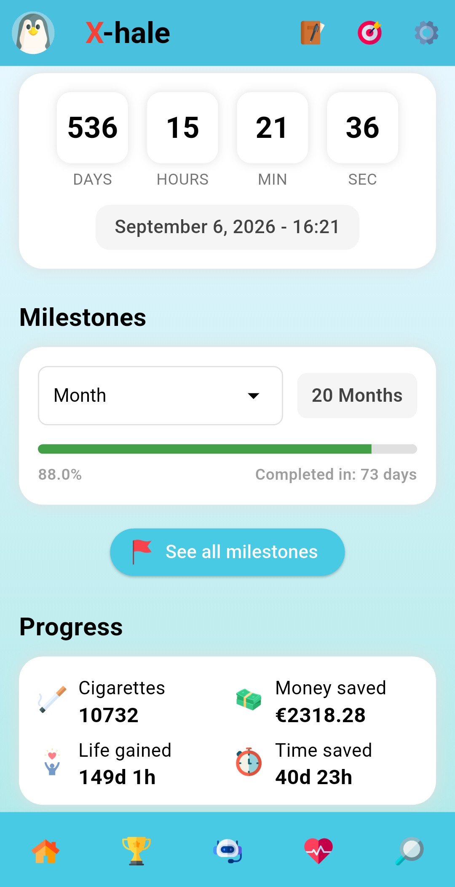
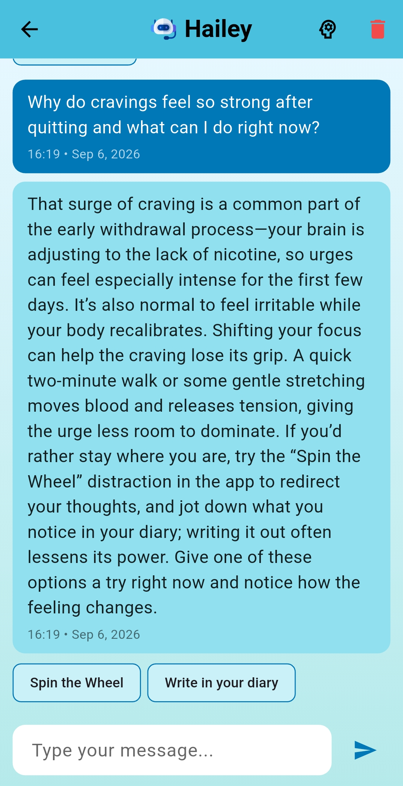
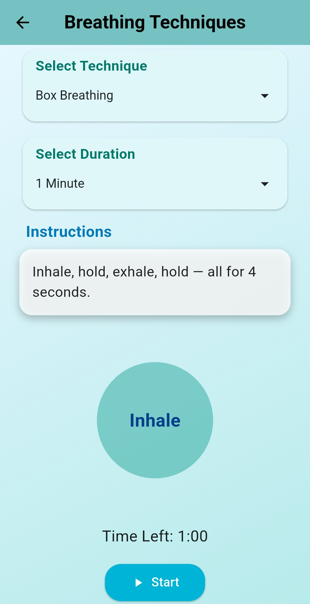
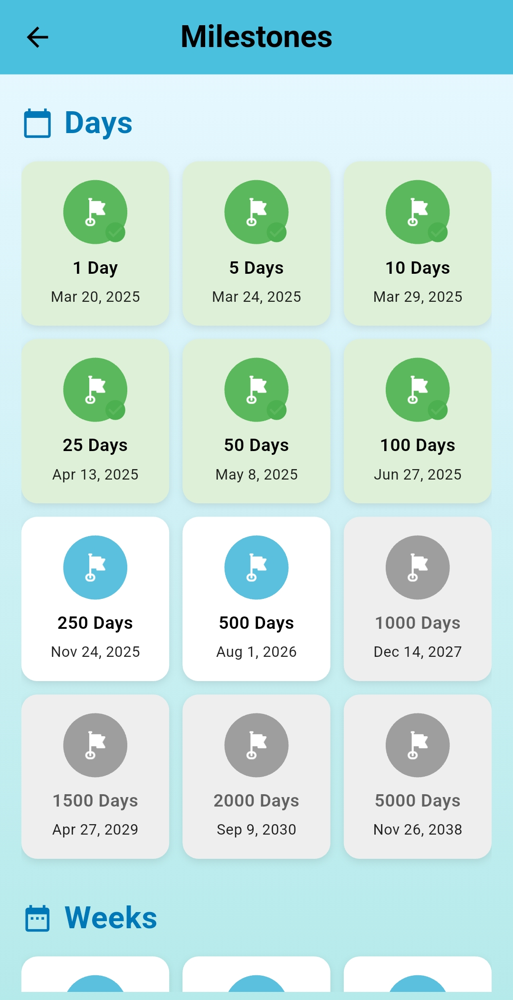
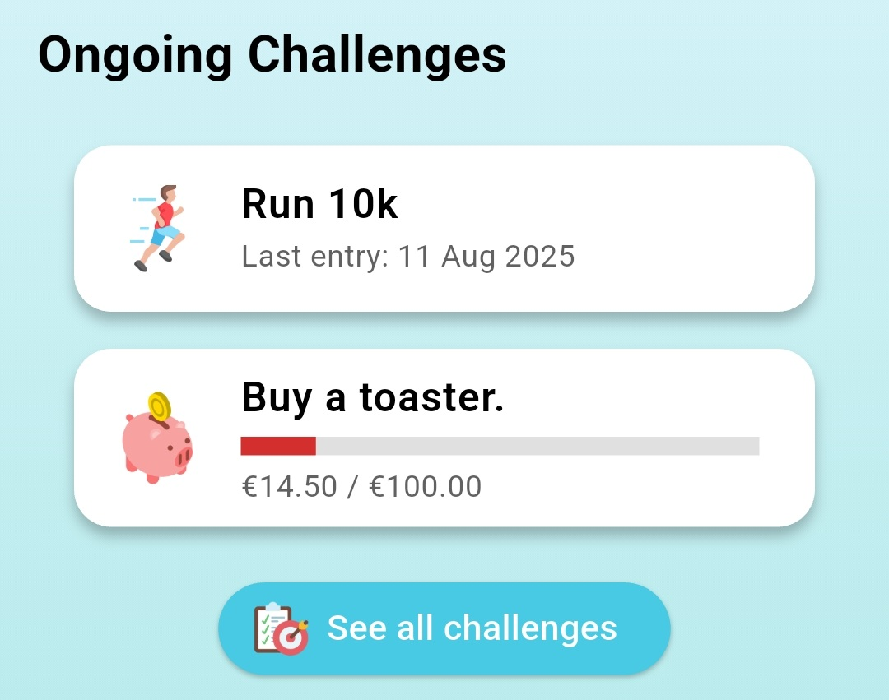
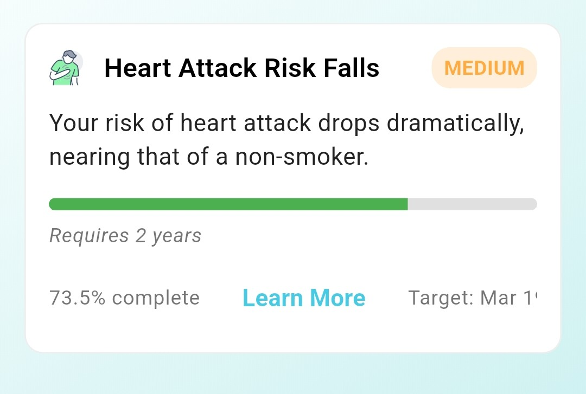

# X-hale — Smoking-cessation companion

X-hale is a Flutter mobile application combining cessation-progress tracking, reflection and coping activities with **Hailey**, a retrieval-augmented conversational assistant built with Python, FastAPI and LangGraph.

**Status:** Research prototype. The application and assistant provide cessation support and information; they are not a diagnostic service, a clinically validated treatment, or an emergency service.

## Preview

| Progress dashboard | Hailey conversation | Guided breathing |
| --- | --- | --- |
| <a href="docs/images/progress-dashboard.webp"></a> | <a href="docs/images/hailey-conversation.webp"></a> | <a href="docs/images/guided-breathing.webp"></a> |

<details>
<summary>More application screens: milestones, challenges and health information</summary>

<table>
  <tr><th>Milestones</th><th>Challenges and health information</th></tr>
  <tr>
    <td align="center" valign="top">
      <a href="docs/images/milestones.webp"></a>
    </td>
    <td align="center" valign="top">
      <p><strong>User-defined financial challenge</strong></p>
      <a href="docs/images/challenges.webp"></a>
      <p><strong>Informational health-benefit card</strong></p>
      <a href="docs/images/health-benefit.webp"></a>
    </td>
  </tr>
</table>

*The health-benefit card is informational; its timeline and progress display do not measure an individual's physiological recovery.*

</details>

*Updated application captures supplied in `Pics/`, with the phone's status and system navigation bars removed. The app's own controls and displayed content are preserved. Select an image to view it at full resolution.* See [screenshot provenance](docs/images/README.md).

## Application features

| Area | Implemented scope |
| --- | --- |
| Progress | Quit timer, estimated cigarettes avoided and money saved, milestones, achievements and an informational health-benefit timeline. Estimates are not measurements of an individual's physiological recovery. |
| Coping | Guided breathing, stretching, drawing, audio activities and mini-games. |
| Reflection | Diary entries, motivations and user-defined challenges. |
| Social | Friends, community posts and direct messaging, backed by Appwrite. |
| Hailey | Context-aware routing, specialist drafts, knowledge retrieval, citation checks, app-action links, conversation history and user-managed remembered facts. |
| Biometrics | **Demonstration data only.** No wearable readings or working Samsung Health integration. |

## Hailey: current implementation

The active backend is [`rag_backend2.0/`](rag_backend2.0/):

```text
Authenticated chat request
  → deterministic crisis precheck (positive → fixed crisis guidance → completion)
  → otherwise, load user context
  → model triage
  → routing: crisis guidance / clarification / scope redirect / specialists
  → sequential specialist dispatch where needed
  → synthesis and citation/safety post-processing
  → emit response content through SSE
  → persist the turn and await eligible memory curation
  → terminal done event
```

The `/chat/` endpoint uses a preparation graph that stops after specialist drafting. The endpoint coordinates synthesis, post-processing and completion. A complete graph variant also exists; it is not the graph used by the active endpoint.

### Models and retrieval

| Component | Repository default |
| --- | --- |
| Triage, specialists and memory extraction | Groq `openai/gpt-oss-20b` |
| Final synthesis | Groq `openai/gpt-oss-120b` |
| Embeddings | Cloudflare Workers AI `@cf/baai/bge-small-en-v1.5`, with an optional same-model local fallback |
| Knowledge store | Qdrant: cessation and health-benefit chunks |
| Graph expansion | Implemented, **disabled by default** |
| Cross-encoder reranking | Implemented, **disabled by default** |
| Web-search fallback | Implemented, **disabled by default** |

Defaults are defined in [`app/config.py`](rag_backend2.0/app/config.py); environment variables can override them. The active model factories select Groq. Retained Gemini files do not make Gemini the default provider; a Gemini key alone does not configure the active path.

Retrieval normally uses vector search and metadata filtering. Optional graph, reranker and web paths require explicit configuration and validation. [`sources.yaml`](rag_backend2.0/ingestion/sources.yaml) records the intended corpus and governance metadata, not proof of a deployed Qdrant collection's contents.

### Memory and response delivery

Hailey assembles a snapshot from Appwrite profile data, recent conversation records and selected remembered facts. Users can inspect and delete facts through the app's memory screen. Extracted facts and confidence scores are model outputs, not independently verified personal or clinical records.

The turn is saved before eligible memory curation. Curation is lifecycle-managed, retried with bounded backoff, shielded against client disconnects, and **awaited before `done`**. It is skipped for the configured benchmark user and some intent categories. This is not fire-and-forget processing; see [`curation_tasks.py`](rag_backend2.0/app/memory/curation_tasks.py).

The API uses server-sent events for status, response content and completion. Model synthesis is buffered and post-processed **before model text reaches the client**. SSE transport does not imply immediate token-by-token model output. The `token` event carries `{"token": "..."}`.

### Safety boundaries

A deterministic precheck can route a detected crisis directly to a fixed response; model triage can also select that response. The crisis guidance itself is constructed without a generative-model call. This does not mean every dangerous message is detected, the entire request lifecycle avoids model calls, or the resource list covers every country and language.

Citation checks and output filtering are safeguards with limitations, not guarantees of medical accuracy or complete risk detection. The automated benchmark is a developer-authored scenario evaluation, not independent clinical validation or evidence of production uptime. See [limitations and roadmap](docs/ROADMAP.md) and [benchmark documentation](finetune/eval/README.md).

## Repository layout

```text
lib/                    Flutter application, providers, models and services
assets/, fonts/         Application media and fonts; separate rights review applies
test/                   Flutter tests
rag_backend2.0/         Active Hailey backend, tests and ingestion tools
rag_backend/            Legacy ChromaDB-era backend and historical resources
finetune/eval/          Scenario benchmark, judge prompts and aggregation
.github/workflows/      Benchmark execution/aggregation and keep-alive
docs/                   Setup, roadmap and screenshot instructions
```

`rag_backend/` is historical implementation context, not a second service required by Hailey 2.0. Its ChromaDB store, temporary-tunnel setup and old resource loaders are not the active backend. Start new development in `rag_backend2.0/`; do not combine the two setup guides.

## Run locally

You need Flutter with a Dart SDK satisfying `^3.7.2`, Python 3.11+, a mobile development environment and configured service accounts. `^3.7.2` is a **Dart** constraint, not a Flutter version number. Appwrite provisioning and client configuration are required; this is not a self-contained, one-command demo.

Follow the [setup guide](docs/SETUP.md) for service configuration, Appwrite requirements, Firebase setup, knowledge ingestion and networking.

Backend, from the repository root:

```bash
cd rag_backend2.0
python -m venv .venv
# POSIX activation: source .venv/bin/activate
# PowerShell activation: .\.venv\Scripts\Activate.ps1
python -m pip install -r requirements.txt
python -m pip install -e ".[dev]"
cp .env.example .env
# Configure your own services in .env before starting.
python -m uvicorn app.main:app --reload --port 7860
```

PowerShell also supports `Copy-Item .env.example .env`. Do not overwrite an existing configured `.env`.

Flutter, in a second terminal at the repository root:

```bash
flutter pub get
# Android emulator reaches the host through 10.0.2.2:
flutter run --dart-define=HAILEY_API_URL=http://10.0.2.2:7860
```

For a USB-connected Android phone, run `adb reverse tcp:7860 tcp:7860`, then use `--dart-define=HAILEY_API_URL=http://localhost:7860`. Other devices need a reachable host address; a device's `localhost` normally refers to the device itself.

## Verification and API

```bash
# Repository root
flutter analyze
flutter test

# rag_backend2.0/, with development dependencies installed
python -m pytest tests/unit/
```

Live integration tests and benchmark campaigns need external services and may consume provider quota. See the [backend guide](rag_backend2.0/README.md), [architecture](rag_backend2.0/ARCHITECTURE.md), [ingestion guide](rag_backend2.0/ingestion/README.md) and [evaluation guide](finetune/eval/README.md).

User-data endpoints require an Appwrite JWT. Operational endpoints such as `/live`, `/ready` and `/metrics` have separate exposure considerations; not every endpoint is authenticated. Liveness does not prove dependency readiness. Benchmark workflows can retain results despite individual failures: a green Actions run alone does not establish that every quality gate passed.

## License and assets

Original X-hale code owned by Stefanos Theos is licensed under the [MIT License](LICENSE). Dependencies, fonts, images, audio, logos, source documents and external knowledge content retain their own terms. See [third-party material and release requirements](THIRD_PARTY_NOTICES.md).

Documentation cleanup does not itself clear all assets or historical content for redistribution. Remaining work is tracked in [the roadmap](docs/ROADMAP.md).
